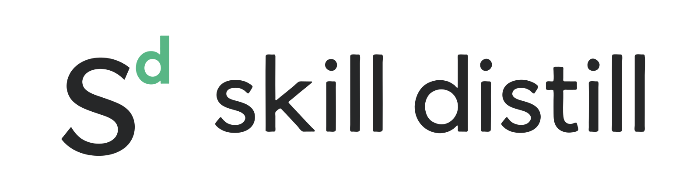

<picture>
  <source media="(prefers-color-scheme: dark)" srcset="assets/banner-dark.png">
  <source media="(prefers-color-scheme: light)" srcset="assets/banner-light.png">
  
</picture>

**English** | [简体中文](README.zh-CN.md)

[](https://x.com/1zrum)
[](https://github.com/izerume/skill-distill/actions/workflows/tests.yml)
[](https://www.python.org/)
[](skills/skill-distill/SKILL.md)

# Skill Distill

Help your agent organize its skill library, combine related skills, and check the result on real tasks.

New skills appear in your feeds every day. You install one after another—but how many have you forgotten about right after installing them? And how often have you handed your agent a dozen skills at once?

Skill Distill is working to solve these problems. It can reduce the number and size of redundant skills without losing their capabilities—and can even improve results in some scenarios.

**[Read SKILL.md](skills/skill-distill/SKILL.md)**

## Installation

Run this in your project directory:

```bash
npx skills add izerume/skill-distill --skill skill-distill
```

Then invoke `skill-distill` in your agent. For example:

```text
$skill-distill Look over my skill library. Group skills by name and description,
then suggest groups worth distilling. Keep this to a quick first pass.
```

Continue managing source skills with [npx skills](https://github.com/vercel-labs/skills). Save distilled skills to the directory you choose in your project.

For a library-wide request, Skill Distill first scans common project and user skill locations, then asks which sources to use and whether to include official/system skills and plugins. It classifies and distills only the selected inputs. Existing explicit choices carry forward; naming exact packages does not trigger another whole-library selection.

## What does it help with?

### Too many skills, and no clear place to start

Some skills repeat the same rules. Others handle different stages of a task. Grouping them by purpose reveals which can share methods or a common entry point.

Skill Distill starts with names and descriptions, suggests groups, then inspects the sources for the groups you select.

### Merged instructions lose the original workflow

Related workflows can share principles while keeping their own interaction patterns. Collecting fragments, shaping an article, and choosing writing beats are a useful example.

Skill Distill records source capabilities, consolidates shared material, preserves the necessary branches, and checks the result on a small set of real tasks. You can name the skills to merge:

```text
$skill-distill Merge these writing skills while preserving their workflows.
Save the result to distilled/writing-workbench in this project.
Run a quick comparison of the originals and the merged skill, then stop if no issues appear.
```

### Keeping distilled skills up to date

Your agent can check for source changes and identify affected outputs. An explicit update request starts a rebuild from the selected sources, followed by smoke checks and a switch to the new version. Saved packages remain available for restoration.

```text
$skill-distill Check whether writing-workbench's sources have changed. Do not update it yet.
```

```text
$skill-distill Update writing-workbench from the currently installed sources.
Switch after smoke checks pass. Preserve any local edits I have made.
```

```text
$skill-distill Restore writing-workbench to r000001.
```

## Further reading

- **Choosing inputs:** [Source selection](skills/skill-distill/references/source-selection.md) · [Classification](skills/skill-distill/references/classification.md) · [Target selection](skills/skill-distill/references/target-selection.md)
- **Building and checking:** [Behavior contracts](skills/skill-distill/references/contracts.md) · [Evaluation](skills/skill-distill/references/evaluation.md)
- **Maintenance:** [Updates and restoration](skills/skill-distill/references/versioning.md)

## References and acknowledgements

These works informed the approach to preserving capabilities, composing workflows, and checking candidates on actual tasks:

- [**SkillFusion: Towards Reliable Multi-Skill Composition for LLM Agents**](https://arxiv.org/abs/2610.15481) — Enhao Huang et al., 2026. Constraints with provenance, explicit conflict handling, and instruction deduplication.
- [**SkillComposer: Learning to Evolve Agent Skills for Specification and Generalization**](https://arxiv.org/abs/2606.06079) — Qi Zhang et al., 2026. Creating, merging, and improving skills using task feedback.
- [**One Skill Takes Over: Clashing Agent Skills and a One-File Fix**](https://arxiv.org/abs/2610.25064) — Parsa Razmara, Seyedarmin Azizi, and Ardalan Aryashad, 2026. SkillClash, interference between combined skills, and the importance of correct joint examples.

The authoring workflow also draws on [gaia-research/skill-fuse](https://github.com/gaia-research/skill-fuse). The README structure was inspired by [mattpocock/skills](https://github.com/mattpocock/skills).

<details>
<summary><strong>Development and tests</strong></summary>

Python 3.10 or later is required. The internal scripts use the standard library to handle fingerprints, snapshots, and version operations. The agent handles semantic decisions and generation.

Run from the repository root:

```bash
python -X utf8 -B tests/run_tests.py
```

Tests cover target selection, read-only inspection, historical inputs, evidence binding, version switching, and recovery after process exits. They do not call a model. GitHub Actions runs the same suite on Windows and Linux.

</details>
